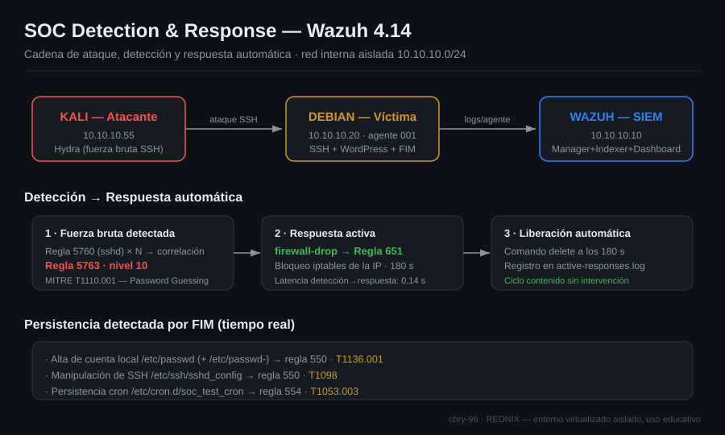

# SOC Detection Lab — Wazuh 4.14


## Abstract

This lab builds a self-contained SOC detection environment on an isolated VirtualBox
network (10.10.10.0/24) using **Wazuh 4.14** (Manager, Indexer and Dashboard) as
the SIEM. A monitored Debian endpoint running the Wazuh agent, SSH and a WordPress
web server is attacked from a Kali Linux host to exercise the full blue-team
detection workflow. The exercise simulates an **SSH brute-force attack** (Hydra),
**network reconnaissance** (Nmap), and **host persistence** through file-integrity
changes to `/etc/passwd`, the SSH daemon configuration and cron. Each action is
detected by native Wazuh rules and mapped to **MITRE ATT&CK** (T1110.001, T1046,
T1136.001, T1098, T1053.003), then triaged, investigated and documented as a security
incident, closing with an **active response** (`firewall-drop`) that blocks the
attacker's IP address. The lab demonstrates practical SOC skills — SIEM deployment,
log and FIM monitoring, alert triage, incident analysis and automated response —
reproducible from the documented steps and evidence in this repository.

---

> ⚠️ **Aviso ético.** Todo el ejercicio se realiza en un entorno virtualizado y
> aislado (red interna de VirtualBox, sin salida a Internet ni a otras redes). Las
> técnicas ofensivas se usan exclusivamente para generar telemetría y practicar la
> **detección y respuesta** defensiva. No deben emplearse contra sistemas sin
> autorización expresa.

## 1. Objetivo

Montar un laboratorio de operaciones SOC con Wazuh como SIEM, simular una cadena de
ataque realista contra un endpoint monitorizado y **detectar, analizar y responder**
a cada acción desde el dashboard, documentando el incidente con evidencias
reproducibles.

## 2. Entorno

Hipervisor: **VirtualBox**. Red interna aislada: **10.10.10.0/24**.

| Máquina | Nombre en Wazuh | IP | SO | Rol |
|---------|-----------------|----|----|-----|
| Servidor SIEM | `wazuh-server` | 10.10.10.10 | OVA oficial de Wazuh (Amazon Linux 2023), disco 50 GB | Wazuh 4.14 all-in-one (Manager + Indexer + Dashboard) |
| Endpoint víctima | `debian-wordpress` (agente 001, host `debianserver`) | 10.10.10.20 | Debian GNU/Linux 13 · 2 vCPU · 3,8 GB RAM | Wazuh Agent v4.14.4 + SSH + WordPress |
| Atacante | — | 10.10.10.55 | Kali Linux | Origen de los ataques (SSH) |

Las tres VMs comparten la red interna `LabNetwork` (10.10.10.0/24) con **IP fija**,
aislada de la red externa. Cada VM mantiene un segundo adaptador (NAT/puente) solo para
salida a internet.

```
   Kali (10.10.10.55) ──SSH──▶ debian-wordpress (10.10.10.20) ──logs──▶ wazuh-server (10.10.10.10)
       atacante                  endpoint + agente Wazuh                   SIEM + dashboard
```

### Resumen visual



*Diagrama de la cadena completa: ataque → detección (reglas Wazuh) → respuesta activa → persistencia por FIM, con el mapeo MITRE ATT&CK.*

## 3. Fases

El procedimiento operativo completo, con todos los comandos y verificaciones, está en
[`notes/guia-ejecucion.md`](notes/guia-ejecucion.md). Resumen:

1. **Despliegue de Wazuh** — Instalación all-in-one en `wazuh-server`, IP estática,
   verificación de servicios y acceso al dashboard.
2. **Instalación del agente** — Agente Wazuh en `debian-wordpress` enrolado contra el manager;
   verificación de estado *Active* en el dashboard. Preparación de `KALI`.
3. **Simulación de ataques** — Desde Kali contra `debian-wordpress`:
   - Fuerza bruta SSH con **Hydra** → regla **5763** (*SSHD brute force*).
   - Reconocimiento de red con **Nmap** (SYN + agresivo) → recolección vía logs.
   - Modificación monitorizada por **FIM**: alta de usuario en `/etc/passwd`, cambio
     en `/etc/ssh/sshd_config` y tarea en `/etc/cron.d/`.
4. **Análisis y respuesta SOC** — Triaje de alertas, investigación del incidente,
   informe y **respuesta activa** (`firewall-drop`) que bloquea la IP de `KALI`.

## 4. Mapeo MITRE ATT&CK

| Acción simulada | Detección | Técnica ATT&CK |
|-----------------|-----------|----------------|
| Intentos SSH fallidos (detectado) | Reglas 5760, 5557, 2502 | **T1110.001** — Password Guessing · **T1021.004** — Remote Services: SSH |
| Fuerza bruta SSH sostenida | Regla 5763 | **T1110.001** — Brute Force: Password Guessing |
| Escaneo de puertos | Logs de red / IDS | **T1046** — Network Service Discovery |
| Alta de usuario local (`/etc/passwd`) | FIM | **T1136.001** — Create Account: Local Account |
| Modificación de `sshd_config` | FIM | **T1098** — Account Manipulation |
| Tarea cron de persistencia | FIM | **T1053.003** — Scheduled Task/Job: Cron |

## 5. Configuraciones aplicadas

Fragmentos de `ossec.conf` listos para usar (ver carpeta [`configs/`](configs/)):

- [`configs/manager-active-response.conf`](configs/manager-active-response.conf) —
  Respuesta activa `firewall-drop` en el manager, disparada por la regla 5763.
- [`configs/agent-fim-syscheck.conf`](configs/agent-fim-syscheck.conf) —
  Monitorización de integridad (FIM) en tiempo real de `/etc`, `/etc/ssh` y
  `/etc/cron.d` en el agente.

## 6. Hallazgos

> Severidad: 🔴 Alta · 🟡 Media · 🟢 Baja. Las evidencias se incorporan tras ejecutar
> el lab (carpeta `evidence/`).

| # | Hallazgo | Severidad | Técnica | Evidencia |
|---|----------|-----------|---------|-----------|
| 1 | Intentos de acceso SSH fallidos contra la cuenta `cbry` desde 10.10.10.55 (Kali). Detectados en tres capas: sshd (5760, nivel 5), PAM `unix_chkpwd` (5557, nivel 5) y correlación de fallos repetidos (2502, nivel 10). 8 alertas el 2026-10-23 a las 21:30 (UTC+2). | 🟡 | T1110.001, T1021.004 | `f3-01`, `f3-02`, `f3-03` |
| 1b | **Fuerza bruta SSH detectada y bloqueada automáticamente.** Ataque con Hydra desde 10.10.10.55 contra la cuenta `cbry` (11 intentos). A los 8 fallos saltó la regla **5763** (nivel 10) y, 0,14 s después, la respuesta activa `firewall-drop` disparó la regla **651**, bloqueando la IP del atacante vía iptables durante 180 s (verificado: ping sin respuesta y comando `delete` a los 3 min en `active-responses.log`). MITRE T1110 — Credential Access / Brute Force. 2026-10-25 23:12:45 (UTC+2). | 🔴 | T1110.001 | `f3-07`, `f3-08`, `f3-09`, `f3-10` |
| 1c | **FIM en tiempo real validado.** Tras activar `realtime="yes"` en el agente, Wazuh registró al instante el ciclo de vida de ficheros de prueba en `/etc/wazuh-fim-lab/` y `/etc/wazuh-film-lab/`: alta (554), modificación (550) y borrado (553). En la alerta 550 de `prueba.txt` (2026-10-25 16:52:14) constan `syscheck.mode: realtime`, tamaño 7 → 14 bytes, hashes MD5/SHA1/SHA256 antes y después, propietario `root` y permisos `rw-r--r--`. En `fim-lab` la primera escritura figura como 550 y no como 554 porque el fichero ya existía y fue sobrescrito: Wazuh refleja el estado real del disco. | 🟢 | — (validación de control) | `f3-04`, `f3-05` |
| 3 | **Creación de cuenta local no autorizada** (`soc_test_user`) detectada por FIM sobre `/etc/passwd` y su respaldo `/etc/passwd-` (regla 550). 2026-10-25 22:06. | 🔴 | T1136.001 | `f3-06` |
| 4 | **Manipulación de la configuración de SSH** (`/etc/ssh/sshd_config`) detectada por FIM (regla 550). | 🟡 | T1098 | `f3-06` |
| 5 | **Mecanismo de persistencia vía cron** (`/etc/cron.d/soc_test_cron`) detectado por FIM como fichero nuevo (regla 554). | 🔴 | T1053.003 | `f3-06` |
| 6 | Reconocimiento de red con Nmap: **no detectado de forma nativa** por el agente (sin regla de serie fiable). Documentado como trabajo futuro: logging de iptables o integración con Suricata. | 🟡 | T1046 | — (fuera de alcance) |

## 7. Remediación

| Acción | Prioridad | Plazo |
|--------|-----------|-------|
| Forzar autenticación SSH por clave y deshabilitar login por contraseña | Alta | Inmediato |
| Aplicar `fail2ban` / respuesta activa como control permanente | Alta | 24 h |
| Restringir SSH por ACL/firewall a orígenes autorizados | Media | 72 h |
| Auditar `/etc/passwd`, `sudoers` y tareas cron; eliminar artefactos del atacante | Alta | Inmediato |
| Alertar sobre cambios en ficheros críticos vía FIM en tiempo real | Media | 1 semana |

## 8. Evidencias

Las capturas de cada fase se guardan en `evidence/` siguiendo la nomenclatura de la
guía de ejecución. Estructura:

```
evidence/
├── fase1-despliegue/
├── fase2-agente/
├── fase3-deteccion/
└── fase4-analisis-respuesta/
```

## 9. Lecciones aprendidas

- **Un SIEM sin disco deja de registrar en silencio.** El 2026-10-23 el disco del
  servidor (25 GB) llegó al 100 %. El agente seguía *Active* y el manager seguía
  generando alertas (`/var/ossec/logs/alerts/alerts.log`), pero Filebeat fallaba con
  `no space left on device` y el dashboard dejó de mostrar eventos. Diagnóstico
  siguiendo la cadena agente → manager → Filebeat → indexer (`agent_control -l`,
  `filebeat test output`, `df -h`, `journalctl -u filebeat`). Se amplió el disco a los
  50 GB recomendados y se desbloqueó el índice (`read_only_allow_delete`).
- **El FIM por defecto no es en tiempo real.** Escanea cada 12 h (`frequency 43200`);
  un fichero creado y borrado entre escaneos no deja rastro. Se activó
  `realtime="yes"` y se confirmó con el mensaje `Real-time file integrity monitoring
  started` en `ossec.log` (leído con `grep -a`, porque el log contiene datos binarios).
- **Las horas de los logs están en UTC** y el dashboard muestra hora local: el mismo
  evento aparece como 19:30 en `full_log` y 21:30 en `timestamp` (UTC+2).
- **Un mismo intento de acceso deja rastro en varias fuentes** (sshd, PAM y la
  correlación de syslog). La regla de fuerza bruta 5763 solo salta con ~8 fallos desde
  la misma IP en poco tiempo; pocos intentos manuales se quedan en la 2502.
- **"Misma IP" no es "misma red".** El rango 10.10.10.0/24 estaba repartido entre un
  adaptador puente (donde vivían Wazuh y el agente) y la red interna aislada (donde
  estaba el atacante): dos segmentos L2 distintos. El síntoma fue `Destination Host
  Unreachable` (fallo de ARP) pese a tener IP del mismo rango. Se rediseñó el lab para
  que las tres VMs usaran la **red interna `LabNetwork`** con IP fija, requisito para
  que un lab sea aislado y reproducible.
- **Detectar no basta: hay que responder.** El caso solo queda completo cuando la
  detección (5763) desencadena la contención automática (`firewall-drop`, regla 651).
  Esa cadena es lo que distingue un SOC de un simple visor de logs.
- **Filtros frente a búsqueda en el dashboard:** los filtros fijan el contexto
  (agente, `rule.groups`) y la barra de búsqueda hace la pregunta concreta
  (`syscheck.path:*fim-lab*`). Los campos nuevos se añaden a la tabla desde
  *available fields*.

> El análisis completo del incidente (resumen ejecutivo, timeline, mapeo MITRE,
> impacto, contención y recomendaciones) está en
> [`notes/informe-incidente.md`](notes/informe-incidente.md).

## 10. Créditos

Elaborado por **Bryan Calderón Herrera** (REDNIX) como parte de su portafolio de
ciberseguridad. Metodología de detección basada en la documentación oficial de Wazuh.

- GitHub: https://github.com/cbry-96
- LinkedIn: https://linkedin.com/in/bcalderonh

## 11. Referencias

- Wazuh — Deploying agents on Linux: https://documentation.wazuh.com/current/installation-guide/wazuh-agent/wazuh-agent-package-linux.html
- Wazuh — Blocking SSH brute-force with Active Response: https://documentation.wazuh.com/current/user-manual/capabilities/active-response/ar-use-cases/blocking-ssh-brute-force.html
- Wazuh — File Integrity Monitoring: https://documentation.wazuh.com/current/user-manual/capabilities/file-integrity/index.html
- MITRE ATT&CK: https://attack.mitre.org/
